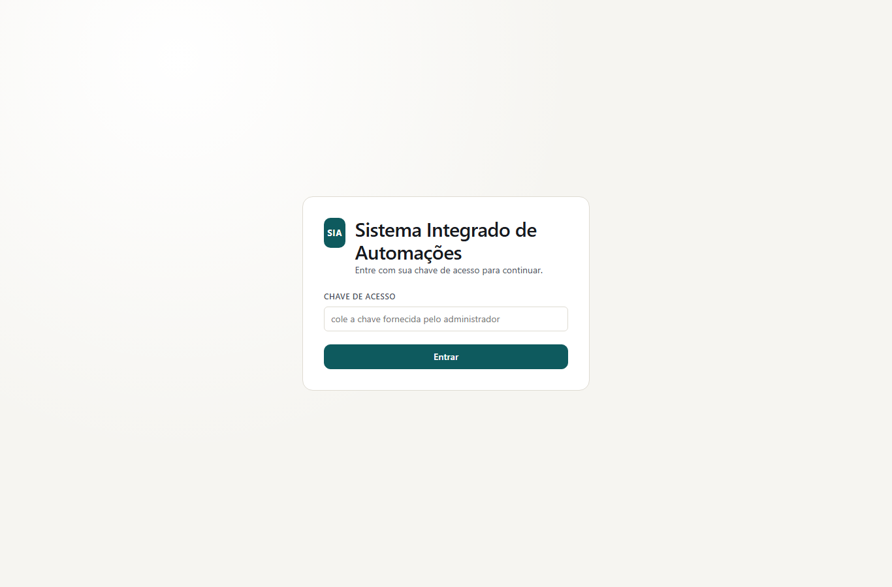

# SIA — Sistema Integrado de Automações

Plataforma de automação extensível: um **Core** pequeno que descobre, autoriza e executa **plugins**,
agenda execuções e orquestra tudo em **workflows** — sem conhecer a lógica de nenhuma automação.

- **Core:** Java 23, SQLite, daemon HTTP com REST, CLI cliente, permissões deny-by-default.
- **Plugins:** em Java (`kind: java`) ou em qualquer linguagem (`kind: process`, JSON Lines).
- **Regra da casa:** nada sensível em banco ou log — só *quem*, *quando* e *o quê*.

## Rodar

Requer **JDK 23**. Os scripts `sia.cmd`/`siad.cmd` usam `%JAVA_HOME%` quando existe, então
funcionam mesmo com outro `java` no PATH.

```bat
mvnw.cmd -DskipTests package

:: iniciar (abre uma janela com o daemon; fechá-la encerra o SIA)
iniciar-sia.cmd
:: ou: sia.cmd start

:: conferir / parar
sia.cmd status
sia.cmd stop

:: usar
sia.cmd --token dev-token plugins
sia.cmd --token dev-token run receitanet.diag
```

No PowerShell: `.\iniciar-sia.cmd` e `.\sia.cmd status`.

### Adicionar um plugin

```bash
# 1. gerar e empacotar (o JAR sai com plugin.yml dentro)
mvn archetype:generate -DinteractiveMode=false \
  -DarchetypeGroupId=com.accord -DarchetypeArtifactId=sia-plugin-archetype \
  -DarchetypeVersion=1.0.0-SNAPSHOT -DgroupId=com.accord.plugins \
  -DartifactId=meu-plugin -Dversion=1.0.0 -DpluginId=meu-plugin \
  -Dpackage=com.accord.plugins.meu
cd meu-plugin && mvn package

# 2. validar e instalar no daemon (sem reiniciar)
curl -X POST localhost:8080/api/plugins/validate -H "Authorization: Bearer dev-token" \
  -H "Content-Type: application/json" -d "{\"path\":\"C:/caminho/meu-plugin-1.0.0.jar\"}"

curl -X POST localhost:8080/api/plugins/install -H "Authorization: Bearer dev-token" \
  -H "Content-Type: application/json" -d "{\"path\":\"C:/caminho/meu-plugin-1.0.0.jar\"}"

# 3. executar
java -jar sia-cli/target/sia-cli-1.0.0-SNAPSHOT-all.jar --token dev-token plugins
```

'## Interface web

O daemon serve a interface em **http://127.0.0.1:8080** (sem build, sem Node):

| Tela | Para quê |
|---|---|
| Painel | execuções em andamento, plugins ativos, falhas recentes |
| Automações | catálogo com formulário gerado dos parâmetros — executar sem saber REST |
| Histórico | últimas execuções com status, duração, ator e log |
| Agendas | criar/pausar/remover execuções automáticas |
| Fluxos | executar workflows e ver o status por etapa |
| Plugins | habilitar, desabilitar e remover |

''Por padrão (`auth.mode: none`) a interface abre direto: a autenticação de verdade acontece dentro
de cada automação — certificado digital, por exemplo. Para exigir chave de acesso, use
`auth.mode: dev` com `auth.tokens` preenchido; aí a primeira visita pede a chave.

Agendas e horários usam o fuso de `scheduler.zone` (`America/Sao_Paulo` por padrão), então
"03:00" significa 03:00 de Brasília mesmo com o servidor em UTC.

A linguagem visual está em [DESIGN.md](DESIGN.md).'


'

## Escrever um plugin'

Guia completo: [docs/PLUGIN_GUIDE.md](docs/PLUGIN_GUIDE.md).

```bash
mvn archetype:generate -DinteractiveMode=false \
  -DarchetypeGroupId=com.accord -DarchetypeArtifactId=sia-plugin-archetype \
  -DarchetypeVersion=1.0.0-SNAPSHOT \
  -DgroupId=com.accord.plugins -DartifactId=meu-plugin -Dversion=1.0.0 \
  -DpluginId=meu-plugin -Dpackage=com.accord.plugins.meu
```

O projeto gerado compila e testa com o `PluginTestKit` sem edição.

## Módulos

| Módulo | Papel |
|---|---|
| `sia-api` | contratos públicos do plugin (única dependência: `slf4j-api`) |
| `sia-core` | loader, engine, scheduler, workflow, persistência, permissões |
| `sia-auth` | papéis, autorização e tokens (OIDC pendente) |
| `sia-server` | daemon HTTP (Javalin) |
| `sia-cli` | cliente do daemon |
| `sia-testkit` | harness para autores de plugin |
| `sia-plugin-archetype` | geração de projeto de plugin |
| `integrations/receitanet-bx` | primeiro plugin real (Receitanet BX) |
| `examples/hello-plugin` | plugin mínimo de referência |

## Verificar

```bash
./mvnw clean verify     # 191 testes + gate de cobertura (core ≥ 80%)
```

Decisões registradas em [docs/adr/](docs/adr/README.md); plano de execução em
[sia-core-plan.md](sia-core-plan.md).
