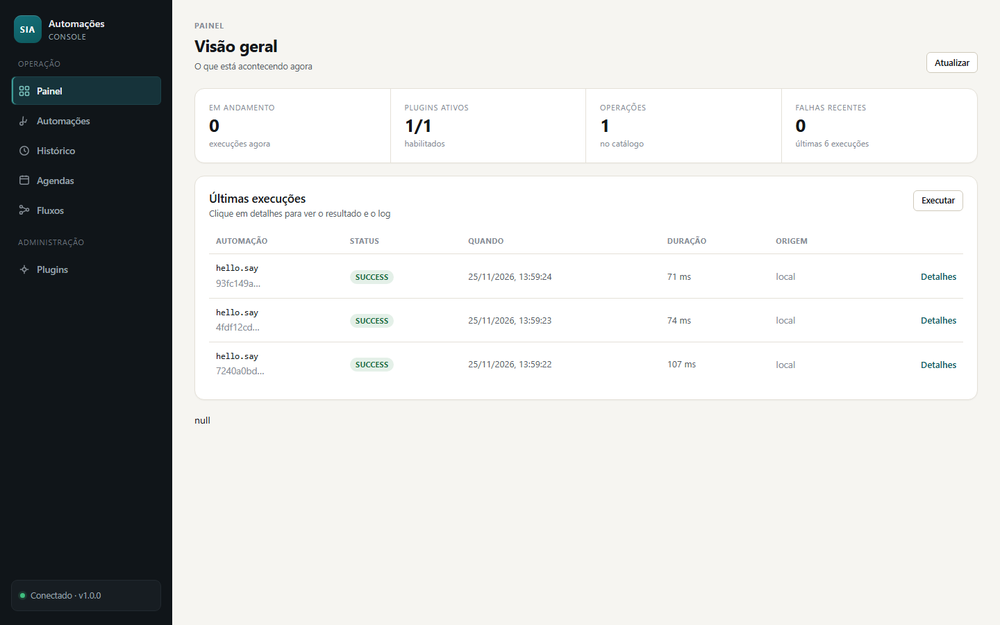
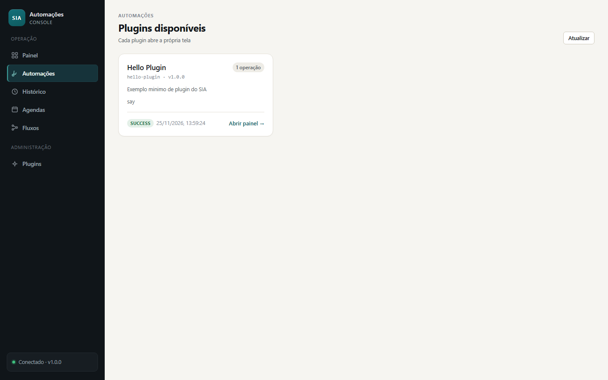
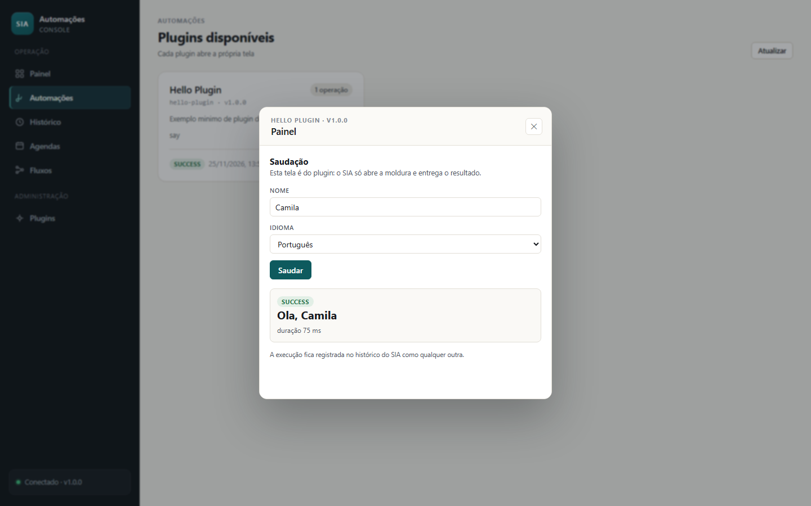
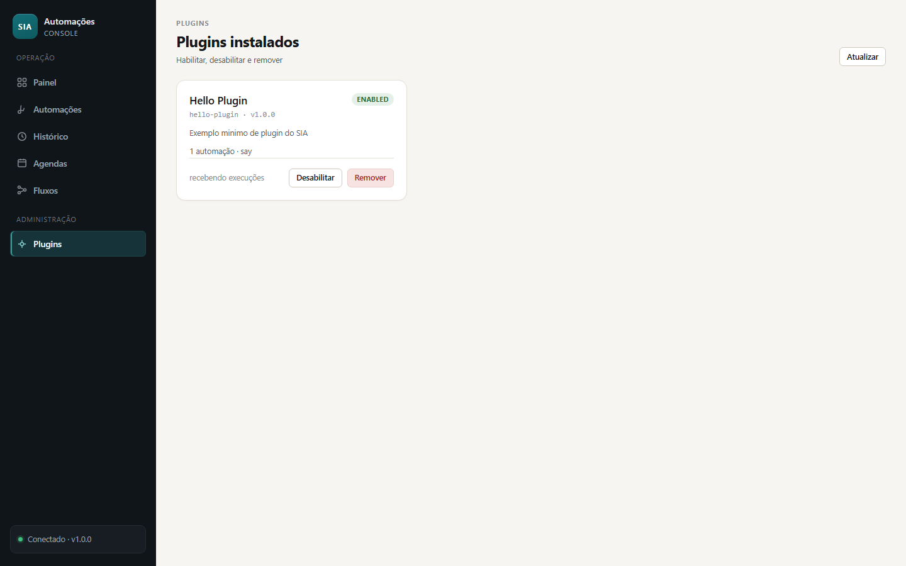

# SIA — Sistema Integrado de Automações

Plataforma de automação extensível: um **Core** pequeno que descobre, autoriza e executa **plugins**,
agenda execuções e orquestra tudo em **workflows** — sem conhecer a lógica de nenhuma automação.

- **Core:** Java 23, SQLite, daemon HTTP com REST, CLI cliente, permissões deny-by-default.
- **Plugins:** em Java (`kind: java`) ou em qualquer linguagem (`kind: process`, JSON Lines).
- **Regra da casa:** nada sensível em banco ou log — só *quem*, *quando* e *o quê*.

## Rodar

Requer **JDK 23** (o enforcer confere; JDK 25 LTS também passa). Os scripts `sia.cmd`/`siad.cmd`
usam `%JAVA_HOME%` quando existe, então funcionam mesmo com outro `java` no PATH.

```bat
:: empacota os jars do daemon e do CLI; -DskipTests pula a suíte na primeira vez
:: (rode ./mvnw clean verify uma vez quando quiser o gate de cobertura + testes)
mvnw.cmd -DskipTests package

:: iniciar (abre uma janela com o daemon; fechá-la encerra o SIA)
sia.cmd start

:: conferir / parar
sia.cmd status
sia.cmd stop

:: usar
sia.cmd plugins
sia.cmd run hello.say
```

No Linux/macOS: `bin/sia start|stop|status` e `bin/siad` (equivalentes `.sh`).

### Adicionar um plugin

A interface (`http://127.0.0.1:8080`) não instala plugins — a instalação é por API:

```bash
curl -X POST localhost:8080/api/plugins/validate \
  -H "Content-Type: application/json" \
  -d '{"path":"C:/build/meu-plugin-1.0.0.jar"}'

curl -X POST localhost:8080/api/plugins/install \
  -H "Content-Type: application/json" \
  -d '{"path":"C:/build/meu-plugin-1.0.0.jar"}'
```

Depois é só executar: `sia.cmd plugins` e abrir o painel do plugin no console. Para **criar** o
JAR a partir do zero, veja [Escrever um plugin](#escrever-um-plugin).

## Interface web

O daemon serve a interface em **http://127.0.0.1:8080** (sem build, sem Node):

| Tela | Para quê |
|---|---|
| Painel | execuções em andamento, plugins ativos, falhas recentes |
| Automações | **um cartão por plugin** (não por automação): abre o painel do plugin, onde a operação é escolhida |
| Histórico | últimas execuções com status, duração, ator e log |
| Agendas | criar/pausar/remover execuções automáticas |
| Fluxos | executar workflows e ver o status por etapa |
| Plugins | habilitar, desabilitar e remover |

Por padrão (`auth.mode: none`) a interface abre direto: a autenticação de verdade acontece dentro de
cada automação — certificado digital, por exemplo. Para exigir chave de acesso, use `auth.mode: dev`
com `auth.tokens` preenchido; aí a primeira visita pede a chave.

Agendas e horários usam o fuso de `scheduler.zone` (`America/Sao_Paulo` por padrão), então "03:00"
significa 03:00 de Brasília mesmo com o servidor em UTC.

A linguagem visual está em [DESIGN.md](DESIGN.md). **Todo plugin traz a própria tela**
([docs/PLUGIN_UI.md](docs/PLUGIN_UI.md)): o console abre a página dele num painel isolado e conversa
por mensagens — o resultado volta com valores, mas o histórico continua guardando só as chaves.






## Escrever um plugin

Guia completo: [docs/PLUGIN_GUIDE.md](docs/PLUGIN_GUIDE.md).

```bash
mvn archetype:generate -DinteractiveMode=false \
  -DarchetypeGroupId=com.accord -DarchetypeArtifactId=sia-plugin-archetype \
  -DarchetypeVersion=1.0.0-SNAPSHOT \
  -DgroupId=com.accord.plugins -DartifactId=meu-plugin -Dversion=1.0.0 \
  -DpluginId=meu-plugin -Dpackage=com.accord.plugins.meu
```

O projeto gerado compila, testa com o `PluginTestKit` e já traz a `ui/panel.html` (interface
obrigatória) sem edição.

## Verificação de tipos do frontend (opcional)

O console não tem build: `app.js` é servido como está. Para pegar erro de nome de campo, uso
indevido de `null` e divergência com a API antes de abrir o navegador, há checagem de tipos com
JSDoc + TypeScript.

```bat
npm install          :: uma vez (só typescript)
npm run check        :: tsc -p tsconfig.json
```

Os tipos vêm do contrato: [types/api.d.ts](types/api.d.ts) é **gerado** de
[sia-server/src/main/resources/openapi.yaml](sia-server/src/main/resources/openapi.yaml) por um
gerador Java — sem Node no build. Se o `openapi.yaml` mudar, o teste `ApiTypesUpToDateTest` falha e
pede a regeração:

```bat
npm run types
```

`mvnw clean verify` continua sem precisar de Node — o Node só é necessário para essa verificação.

## Segurança

- **Sem login (`auth.mode: none`) só em loopback**, e com proteção contra CSRF/DNS rebinding:
  requisições que mudam estado exigem `Host` loopback e rejeitam `Origin` cross-origin.
- **O painel de cada plugin roda em `iframe` sandbox** (`allow-scripts` sem `allow-same-origin`),
  conversando por `postMessage` com validação de origem.
- **Processos filhos não herdam segredos**: o ambiente é sanitizado (variáveis `SIA_SECRET_*`
  são removidas) antes de subir qualquer executável.
- Permissões por papel e deny-by-default para `storage`, `secrets` e `process`.

## Módulos

| Módulo | Papel |
|---|---|
| `sia-api` | contratos públicos do plugin (única dependência: `slf4j-api`) |
| `sia-core` | loader, engine, scheduler, workflow, persistência, permissões |
| `sia-auth` | papéis, autorização e tokens (OIDC pendente) |
| `sia-server` | daemon HTTP (Javalin) |
| `sia-cli` | cliente do daemon |
| `sia-testkit` | harness para autores de plugin |
| `sia-plugin-archetype` | geração de projeto de plugin |
| `examples/hello-plugin` | plugin mínimo de referência |

## Verificar

```bash
./mvnw clean verify     # 220+ testes + gate de cobertura (core ≥ 80%)
```

Há CI em [.github/workflows/ci.yml](.github/workflows/ci.yml) (matriz Windows + Linux) que roda
`./mvnw clean verify` e `npm run check` a cada push e pull request.

Decisões registradas em [docs/adr/](docs/adr/README.md); plano de execução em
[docs/sia-core-plan.md](docs/sia-core-plan.md).
